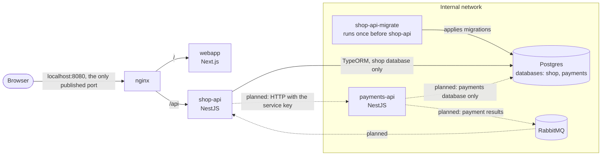

# Architecture

What runs when you start `docker compose up --build`. Solid arrows are built; dashed arrows are part of the checkout and are not built yet.

- **Only nginx is published.** It serves the webapp at `/` and shop-api at `/api`.
- **Containers on the internal network can't be reached from your machine or the internet.** payments-api, Postgres, RabbitMQ and the migration runner are only on that network, and it has no internet access. shop-api is on both networks so nginx can reach it.
- **Each service has its own database and role.** Neither role can connect to the other service's database.
- **Migrations run before the API starts.** `shop-api-migrate` applies them and exits, and shop-api starts only after it succeeds. TypeORM's `synchronize` is off.
- **The health check includes the database.** shop-api's container check calls `/api/health/ready`, which pings Postgres.
