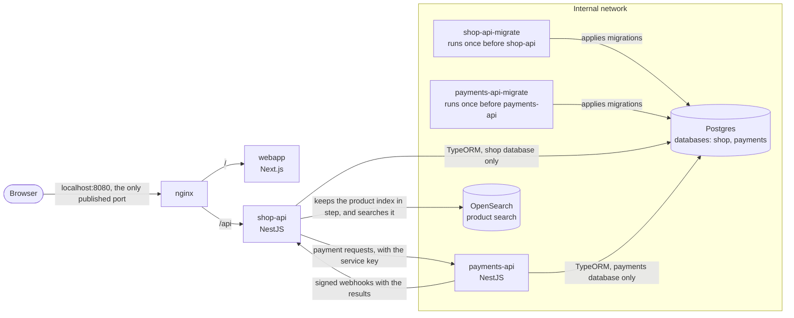

# Architecture

What runs when you start `docker compose up --build`.

- **Only nginx is published.** It serves the webapp at `/` and shop-api at `/api`.
- **Containers on the internal network can't be reached from your machine or the internet.** payments-api, Postgres, OpenSearch and the migration runners are only on that network, and it has no internet access. shop-api is on both networks so nginx can reach it.
- **Each service has its own database and role.** Neither role can connect to the other service's database.
- **Migrations run before each API starts.** `shop-api-migrate` and `payments-api-migrate` apply them and exit, and each API starts only after its runner succeeds. TypeORM's `synchronize` is off.
- **The health checks include the database.** The container checks call shop-api's `/api/health/ready` and payments-api's `/health/ready`, which ping Postgres. OpenSearch is left out on purpose, so a search outage doesn't take the API down.
- **The two services talk over HTTP in both directions.** shop-api asks payments-api for payments with the service key. payments-api reports each result by posting a signed event to shop-api's `/webhooks/payments`, a route outside `/api` that nginx answers with 404. [Checkout flow](checkout-flow.md) has the details.
- **OpenSearch serves search only.** Postgres stays the source of truth, and an outbox filled by a database trigger keeps the index in step. [Product search](product-search.md) has the details.
