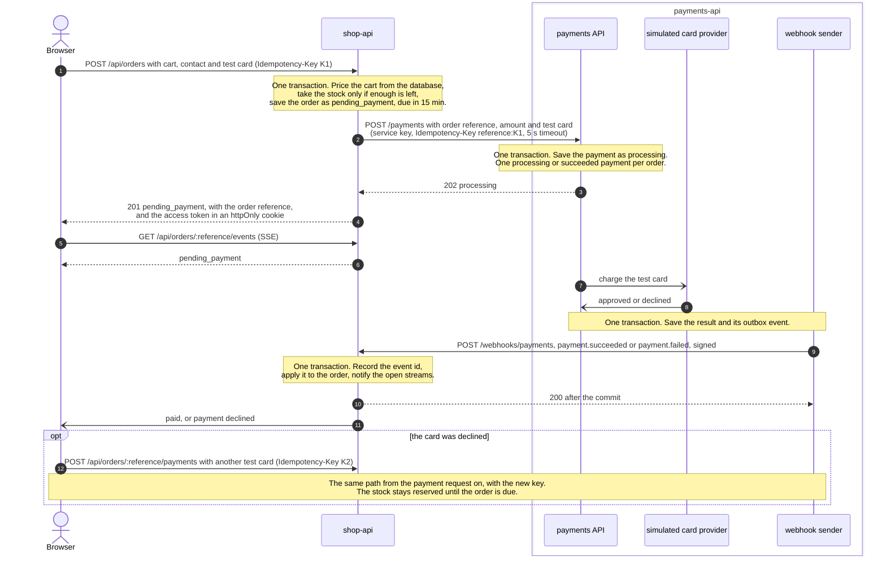
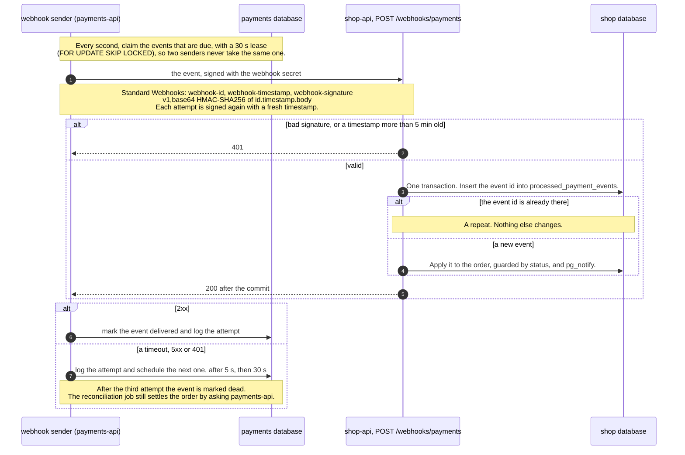
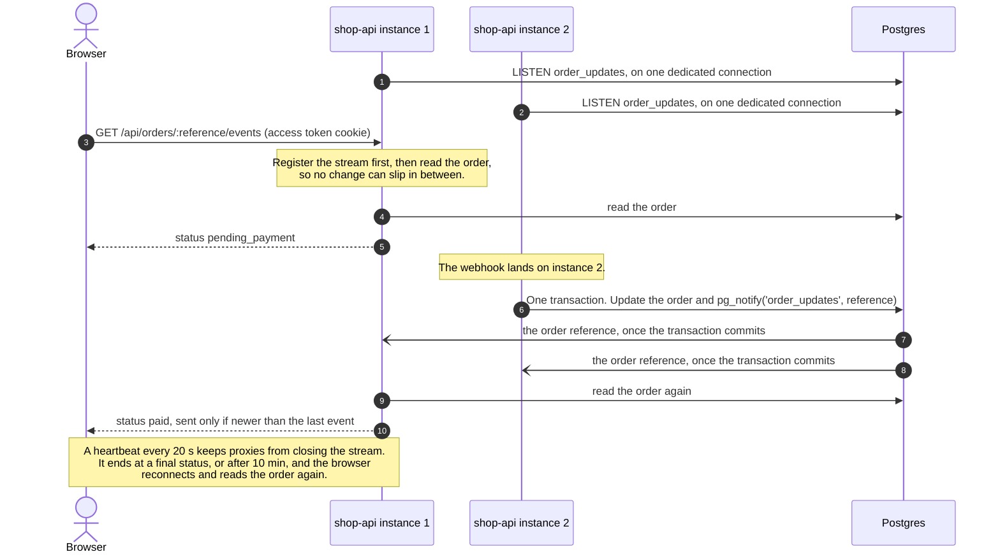
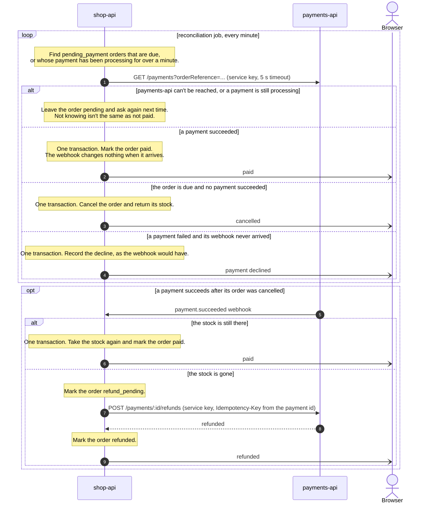
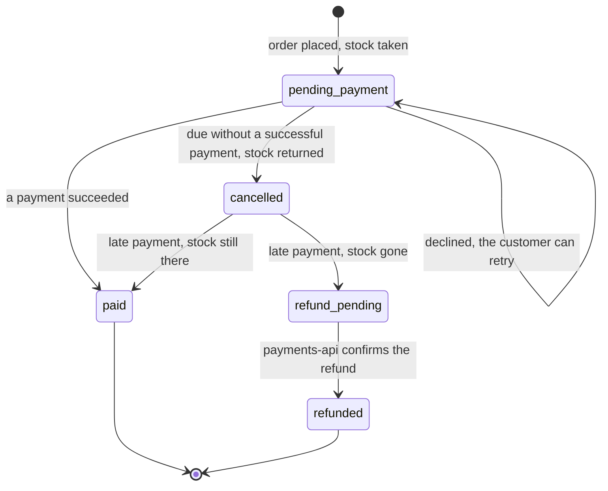

# Checkout flow

This is the design the checkout is being built to, and this page changes in the same commits as the code.

**Status:** everything on this page is built in shop-api and payments-api, and [What the design guarantees](#what-the-design-guarantees) lists the test that proves each guarantee. The webapp's checkout screens are not built yet.

payments-api plays the part of a payment gateway, and shop-api is the merchant. Requests go one way: shop-api asks payments-api to charge a card. Results come back the other way as signed webhooks, which is how gateways such as Stripe and Adyen report payments to merchants.

## 1. Placing an order and paying

- **Each payment attempt has its own Idempotency-Key.** Sending the same request again, after a timeout or a double click, returns the first answer and never charges twice. A retry after a decline is a new attempt with a new key, because the old key would only replay the decline. shop-api puts the order reference in front of the browser's key before passing it to payments-api, so one order's keys can never collide with another's.
- **The access token proves the order is yours.** shop-api sends it as an httpOnly cookie that only that order's routes receive, so page scripts can't read it and the browser sends it with the stream by itself. The order reference is shown on screen and in links, so on its own it proves nothing.
- **The stock is taken when the order is placed,** so an order that gets paid always has its items. An order nobody pays for returns its stock when it's due (section 4).
- **shop-api calls payments-api after its own transaction commits,** never inside it. A timeout means the outcome is unknown: the order stays pending, and a retry with the same key picks up the same payment.

## 2. Delivering a result: the webhook

- **A crash can't lose a result.** payments-api saves each result and its event in one transaction, the outbox, and the sender tries three times to deliver it.
- **Three attempts are enough.** Most failures are short, such as shop-api restarting. If all three fail, the reconciliation job finds the payment within about a minute (section 4).
- **Repeats change nothing.** shop-api records the event id in the same transaction as the change.
- **2xx means "recorded".** shop-api answers 2xx only after its transaction commits. It also answers 2xx for an event it records but can't apply, such as an amount that doesn't match the order or an unknown order, and flags it for a person to check. Only temporary failures, such as the database being down, answer 5xx, so that retrying can help.
- **Only payments-api can send results.** The signature covers the event id, the attempt's timestamp and the exact body, so nobody without the secret can forge or change an event. A timestamp more than five minutes off is refused, so an old request can't be replayed, and the signed id must match the event id in the body. The route sits outside `/api`, so nginx never forwards it, and shop-api checks the signature anyway.
- **Each direction has its own secret.** The service key lets shop-api call payments-api, and the webhook secret signs payments-api's events. Leaking one doesn't give away the other.
- **The sender runs inside payments-api,** started when the app boots and stopped on shutdown. Several instances can run it at once, because each one only sends the events it has leased.
- **The receiver is set in config.** payments-api reads its URL and the webhook secret from the environment, and shop-api reads the same secret. Both are checked at startup.

## 3. Live status over SSE

- **Only committed changes reach the browser.** Postgres delivers a notification only when its transaction commits.
- **Every instance hears every change,** and passes it only to the streams for that order. Nothing is broadcast to every browser or replayed from memory.
- **The notification carries only the order reference.** The stream reads the order from the database, so a reconnect or a missed notification fixes itself on the next read. If the `LISTEN` connection drops, the instance reconnects and reads the order again for every open stream.
- **nginx doesn't buffer the stream.** If the stream can't connect, the browser polls `GET /api/orders/:reference` instead.

## 4. When no result arrives

- **A lost webhook costs about a minute.** The job checks payments that have been processing for over a minute, not only orders that are due.
- **A crash between saving the order and calling payments-api** ends here too: no payment is found, so the order is cancelled when it's due and its stock returned.
- **A refund is retried with the same key until payments-api confirms it,** so a customer is never refunded twice.
- **One gap remains.** If a payment succeeds after its order was cancelled and all three deliveries of its webhook fail, shop-api never hears of it, because the job only checks pending orders. It's rare, and it needs a manual refund.

## Order states

`paid` and `refunded` are final, and `cancelled` is final unless a late payment arrives. Every change is a single `UPDATE` guarded by the current status, so a late or repeated event can't move an order backwards.

## What the design guarantees

- **No overselling.** Taking the stock and creating the order happen in one transaction in shop-api, and the stock is taken only if enough is left.
- **No double charge.** A repeated request reuses its Idempotency-Key and gets the first answer, and payments-api allows one processing or succeeded payment per order, whatever the key.
- **No lost or repeated results, with one exception.** payments-api saves each result and its webhook event in one transaction and tries three times to deliver it. shop-api answers only after its own transaction commits and drops repeats by event id, and the reconciliation job settles pending orders whose webhook never arrived. The exception is a late payment for a cancelled order whose three deliveries all fail (section 4).
- **No forged results.** shop-api applies a result only with a valid signature and a recent timestamp, on a route nginx never forwards.
- **No stuck orders.** The reconciliation job asks payments-api before cancelling, and a payment that succeeds after cancellation gets its stock back or is refunded.
- **The browser never sets the amount.** shop-api prices the cart from the database. payments-api accepts only calls that carry the service key, and it is reachable only inside the Docker network.

Each guarantee has a test that was seen failing against a broken version of the code:

| Guarantee | Test | Broken version it catches |
|---|---|---|
| No overselling | `orders.e2e-spec.ts`: "sells the last unit to only one of two buyers checking out at once" | the row lock and the stock condition both removed |
| No double charge | `payments.e2e-spec.ts` in payments-api: "allows only one active payment per order, whatever the keys" | the partial unique index made non-unique |
| No lost or repeated results | `payment-webhooks.e2e-spec.ts`: "applies an event once, however often it is delivered"; `webhooks.e2e-spec.ts` in payments-api: retries, dead events and the lease | the event id dedupe removed; the lease check removed |
| No forged results | `payment-webhooks.e2e-spec.ts`: "refuses an event that is unsigned, signed with another secret, old or changed"; `webhook-signature` unit tests | a failed verification treated as valid |
| No stuck orders | `reconciliation.e2e-spec.ts`: cancelling due orders, finding lost webhooks, refunds, and "cancels nothing while payments-api cannot be reached" | an unreachable payments-api treated as "no payments" |
| The browser never sets the amount | `orders.spec.ts` in contracts: "refuses a price sent by the browser"; `orders.e2e-spec.ts`: the order is priced from the database | |

## Decisions

- **Webhook signatures follow Standard Webhooks.** `@shop/webhook-signature` wraps `standardwebhooks` 1.1.1, the spec's reference library. Each delivery carries `webhook-id` (the event id, the same on every retry), `webhook-timestamp` and `webhook-signature` (`v1,` and a base64 HMAC-SHA256 of `<id>.<timestamp>.<raw body>`). The receiver accepts several signatures, so the secret can be changed without downtime, and the sender signs with one.
  - *Our own Stripe-style format* was about 80 lines, but it was a protocol we would have had to maintain and explain. A published spec with a maintained library is easier to trust and to integrate with.

- **Payment results come back as signed webhooks, not through a message broker.** payments-api behaves like a real payment gateway: it knows a URL and a secret, not what an order is, and it retries until shop-api confirms or three attempts fail, and the reconciliation job covers what the retries miss. The outbox keeps every result safe, the way a broker would.
  - *RabbitMQ between the services* was the first design. It holds events while shop-api is down, but the outbox already does that. It adds a service to run locally and on AWS, and it redelivers a failed message straight away, so waiting between retries needs extra queues.
  - *shop-api polling payments-api* is simpler still, but results arrive late and every pending order costs a request. The reconciliation job keeps a version of it as the safety net.
- **One Idempotency-Key per payment attempt, not per order.** A key per order would make the first decline permanent, because every retry would replay it. payments-api still allows one processing or succeeded payment per order, whatever the key, so a new key can't charge twice.
- **Three delivery attempts, not days of retries.** Most failures are short, and the reconciliation job finds whatever the retries miss within about a minute. *Retrying for up to three days, as Stripe does,* would only help the rare late payment for a cancelled order.
- **The access token travels in an httpOnly cookie.** The browser's `EventSource` can't send headers, and a cookie is sent by itself and can't be read by page scripts. *A token in the URL* was the alternative, but URLs end up in logs and browser history.
- **The access token is an HMAC of the order reference, made with a server secret.** shop-api stores nothing it would have to keep secret, and a repeated checkout request gets the same token back, so a double click can't leave the browser holding a token that no longer works. The cost is that a token can't be revoked without changing the secret, which is acceptable for guest orders.
- **One receiver, set in config.** Real gateways let merchants register their own webhook endpoints, but there is only one merchant here.

### Webhook retry test timing

The sender marks an event dead after three failed deliveries. Its e2e test asserts each claimed delivery, checks that attempts one and two remain live, and checks that attempt three marks the event dead. Test fixtures explicitly make settlement due using the database clock and webhook delivery due using the application clock. Mixing Postgres `now()` precision with JavaScript millisecond timestamps previously allowed a loop iteration to claim nothing. A regression test holds the application clock behind the database clock to reproduce that boundary without sleeps.

Payment settlement e2e fixtures explicitly set processing payments due using the database clock before running the worker. A test holds the application clock one minute ahead, preventing host/container clock differences from skipping settlement and causing unrelated listing/refund assertions to fail. Production settlement scheduling is unchanged.
