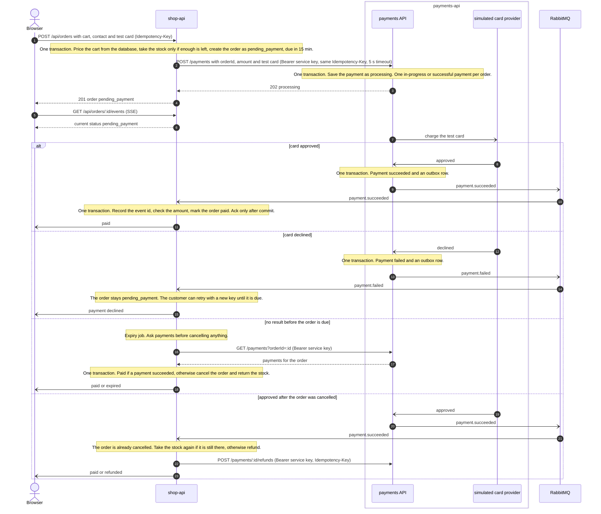

# Checkout flow

This is the design the checkout is being built to. It is not implemented yet, and this page will change in the same commits as the code.

## What the design guarantees

- **No overselling.** Taking the stock and creating the order happen in one transaction in shop-api, and the stock is taken only if enough is left.
- **No double charge.** The browser's Idempotency-Key follows the request into payments-api, which allows one in-progress or successful payment per order.
- **No lost payment results.** payments-api saves each result and its event in one transaction, through an outbox, and shop-api acknowledges a message only after its own transaction commits. Repeated messages are dropped by event id.
- **No stuck orders.** The expiry job asks payments-api before cancelling, and a payment that succeeds after cancellation gets its stock back or is refunded.
- **The browser never sets the amount.** shop-api prices the cart from the database. payments-api accepts only calls that carry the service key, and it is reachable only inside the Docker network.
