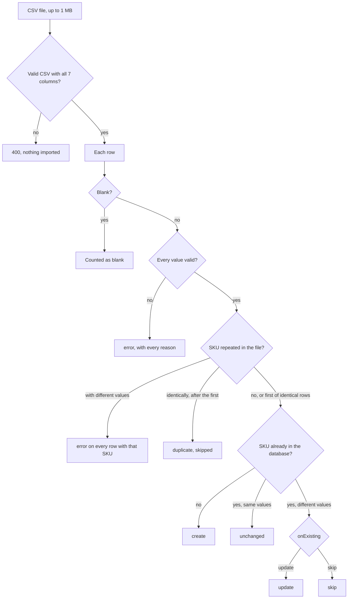

# Product import

`POST /api/products/import` takes a CSV file in a field named `file`, up to 1 MB.

- `dryRun=true` returns the report without writing anything.
- `onExisting=skip` leaves products that already exist untouched. The default, `update`, updates product fields while preserving stock. `updateStock=true` explicitly replaces existing stock.

Every row gets one of these statuses:

## Rules

| Value | Accepted | Rejected |
|---|---|---|
| name | Up to 200 characters after trimming, stored as plain text (markup and SQL included) | Blank, whitespace only, or longer than 200 characters |
| sku | Letters, digits and hyphens, uppercased | Blank, spaces or other characters |
| price | `89.99`, or `$29.99` with the `$` removed and a warning | `free`, `0.00`, more than two decimals |
| stock | Whole numbers; negative stock becomes zero with a shortfall warning | Decimals, text |
| weight_kg | Up to three decimals, `0` allowed. Blank is stored as empty, with a warning | Text, negative numbers |
| category | Any text. Blank becomes `Uncategorized`, with a warning | Longer than 100 characters |

- **Exact arithmetic.** Prices are stored as integer cents and weights as integer grams, with no floating-point math.
- **One transaction.** The import locks the products it matches, then inserts and updates them together.
- **Idempotent.** Importing the same file again leaves every product `unchanged`.

On the challenge CSV the result is 86 products created, 9 rows rejected and 2 blank rows skipped. A test checks this row by row: `backend/shop-api/src/products/import/plan-product-import.spec.ts`. Every problem row is listed in [KNOWN_ISSUES.md](../KNOWN_ISSUES.md).

## Decisions

Each case below is a question a product owner would normally answer. With no one to ask during the challenge, the import takes the answer that loses the least information, and each one is easy to change.

- **The same SKU on several rows with different values** (RS-001 and BS-021 in the example file). Every row of that SKU is rejected and listed in the report, so the import never guesses a price or a stock level. Fixing the file and importing it again is cheap, because the import is idempotent.
  - *Last row wins* is the main alternative: later rows would count as updates, and row 36's description starts with "Updated", which hints at it. A file has no timestamps, though, so row order is weak evidence for a price. Postgres takes the same position: an upsert that touches one key twice in a single statement fails.
  - *First row wins* and *let the admin pick a row in the import preview* were also considered.
  - To change it, edit `resolveRepeatedSkus` in [`plan-product-import.ts`](../backend/shop-api/src/products/import/plan-product-import.ts) and the golden test.
- **The same SKU repeated with identical values.** The first row is imported and the others are reported as `duplicate`. Rejecting them would punish a harmless copy.
- **A SKU that's already in the catalog.** By default the product is updated with the file's values, and `onExisting=skip` leaves it as it is. Rejecting the row instead would make it impossible to import a corrected file.
- **Whether stock is set or added.** Existing stock is preserved by default; with explicit opt-in, the file's stock replaces the current stock, so importing the same file twice changes nothing. Adding stock, as a delivery file would, needs a way to recognize a file that was already applied, so it was left out.
- **A blank category** becomes "Uncategorized", with a warning, so the product can still be sold and recategorized later.
- **A price written as `$29.99`.** A leading `$` is removed, with a warning. Any other text, such as `free`, another currency symbol or a comma for decimals, is rejected, because guessing a currency or a decimal separator is worse than asking for a fix.
- **Blank and zero weights.** A blank weight is stored as empty, with a warning, and `0` is accepted as a real weight, as for the gift card. If shipping is ever charged by weight, products without a weight will need a rule.
- **Names that contain markup or SQL.** They're stored exactly as written. Text like this is only dangerous when it's rendered as HTML or concatenated into SQL, so the protection belongs there: queries pass values as parameters, and the UI must render names as text. Stripping tags during the import would quietly change data.
- **The same name under different SKUs** (Running Shoes is both RS-001 and RS-050). The SKU identifies a product, so they're separate products.

A zero price is rejected because the brief asks for purchases, not a free-product flow. The alternative would accept free products and skip payment; that requires a separate checkout policy. Negative inventory is clamped to zero rather than rejecting an otherwise usable product, with the original shortfall retained in the import report.

## Saved review portal

The [saved import portal](import-portal.md) stores immutable originals, records row edits and requires duplicate decisions before loading. The direct endpoint remains available for authenticated scripts.

### Review guidance

The review screen groups each row's validation errors, warnings and actions in the first review column. Conflicting duplicates are labeled separately from invalid values. Use “Show rows to fix” to filter the saved preview, then “Compare matching rows” to inspect a SKU. Yellow cells identify differences among the rows on the current page; exclude unwanted versions or correct their values. Editable fields have visible borders and save on blur. The review column stays visible during horizontal scrolling on desktop; on narrow screens it scrolls with the table so it does not obscure the fields. Catalog changes and edit attribution remain in the final column.
