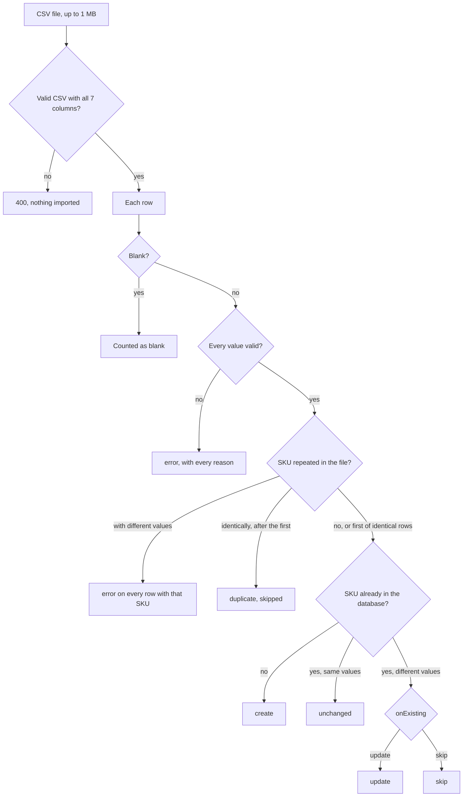

# Product import

`POST /api/products/import` takes a CSV file in a field named `file`, up to 1 MB.

- `dryRun=true` returns the report without writing anything.
- `onExisting=skip` leaves products that already exist untouched. The default, `update`, overwrites them with the file's values.

Every row gets one of these statuses:

## Rules

| Value | Accepted | Rejected |
|---|---|---|
| name | Up to 200 characters after trimming, stored as plain text (markup and SQL included) | Blank, whitespace only, or longer than 200 characters |
| sku | Letters, digits and hyphens, uppercased | Blank, spaces or other characters |
| price | `89.99`, or `$29.99` with the `$` removed and a warning | `free`, `0.00`, more than two decimals |
| stock | Whole numbers from 0 | Negative numbers, decimals, text |
| weight_kg | Up to three decimals, `0` allowed. Blank is stored as empty, with a warning | Text, negative numbers |
| category | Any text. Blank becomes `Uncategorized`, with a warning | Longer than 100 characters |

- **Exact arithmetic.** Prices are stored as integer cents and weights as integer grams, with no floating-point math.
- **One transaction.** The import locks the products it matches, then inserts and updates them together.
- **Idempotent.** Importing the same file again leaves every product `unchanged`.

On the challenge CSV the result is 85 products created, 10 rows rejected and 2 blank rows skipped. A test checks this row by row: `backend/shop-api/src/products/import/plan-product-import.spec.ts`.
