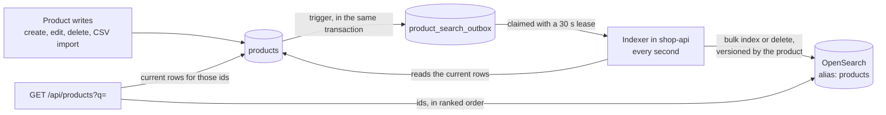

# Product search

Search runs on OpenSearch 3.5, and Postgres stays the source of truth. The storefront calls one endpoint, `GET /api/products`. With `q` it searches OpenSearch, and without `q` it lists straight from Postgres, so browsing by category keeps working when OpenSearch is down.

## What it finds

A product matches when its SKU starts with the search, or when every word of the search is found in the product. From three words on, three in four are enough, so one extra word doesn't empty the results. A word is found when it is:

- **the start of a word in the name,** ignoring case and accents: `RUNN` finds Running Shoes, and `cafe` finds a product named Café Table;
- **a word in the name with a typo:** one letter wrong, missing or extra, or two letters swapped, in words of 4 to 7 letters, two typos in longer words, and none in shorter ones. `runing` finds Running Shoes;
- **a word in the description:** `ergonomic` finds the Wireless Mouse.

So `charging pad` finds the Wireless Charger, whose description has both words, and not the Mouse Pad, which has only one. The matches rank in this order, with examples from the challenge CSV:

| Match | Example |
|---|---|
| An exact SKU, ignoring case | `rs-050` finds RS-050 |
| A SKU that starts with the search | `rs-05` finds RS-050 |
| A name that starts with the words in order, the last one perhaps unfinished | `running s` finds Running Shoes |
| Words found in the name, at the start of its words or with a typo | `runing sho` finds Running Shoes |
| Words found only in the description | `pad` lists the Mouse Pad, then the Wireless Charger |

- **Filter** by `category`, matched exactly.
- **Sort** by `relevance`, the default with `q`, or `name`, the default without it, or `price_asc`, `price_desc` and `newest`. Ties break by product id, so a page never repeats a product.
- **Page** with `page` and `pageSize`, up to 100 per page and the first 10,000 results.
- **What it doesn't do:** match the middle of a word (`unning` finds nothing), synonyms, or plurals and other word forms beyond the typos above. A search of one or two words finds nothing if one of them is in no product: `wireless headphones` finds nothing, because no product mentions headphones.

## How the index stays in step with the database

- **Every product change is queued in the same transaction.** A database trigger writes the outbox row, so no write path can forget, whether it is the API, the CSV import or a future batch load. It only fires for the fields the index uses, so the stock changes made by orders don't touch it.
- **The indexer sends changes outside any transaction.** It claims up to 500 queued changes with `FOR UPDATE SKIP LOCKED` and a 30 s lease, reads the current rows, and sends one bulk request. A change leaves the queue only after OpenSearch accepted it, and a failed one is retried when its lease runs out.
- **A late, older update can't overwrite a newer one.** Each document carries the product's version as an external version, so OpenSearch refuses anything older than what it has. A delete is sent with the deleted row's version plus one, so it wins over any update queued before it.
- **So every write to a product's name, description, category or price must increase its `version`.** OpenSearch refuses a document whose version isn't higher than the one it holds, and the indexer counts that refusal as done, so a write that keeps the version would never reach the index. TypeORM's `save`, `update` and query builder updates increase it through `@VersionColumn`. Raw SQL, such as a bulk upsert, has to set `version = products.version + 1` itself.
- **What a search shows comes from Postgres.** OpenSearch returns ids in ranked order, and shop-api reads those rows from Postgres. The price and stock shown are always current, and a product deleted a moment ago is left out instead of shown.
- **The index sits behind the alias `products`.** Its settings and mappings are versioned in code, in `product-index.definition.ts`, and `dynamic: strict` refuses any field the code doesn't declare.
  - On first start, the indexer creates the index and queues every product.
  - `pnpm --filter shop-api search:rebuild` builds a new index from Postgres, switches the alias to it, queues every product again to catch changes made in the meantime, and deletes the old index. In Docker, run `docker compose exec shop-api node dist/products/search/rebuild-search-index.js`.

## When OpenSearch is down

- **Searches answer 503** with a message to browse by category. Listing products, product pages, editing and checkout keep working.
- **Changes stay queued in Postgres.** The indexer logs once that it is waiting and catches up when OpenSearch is back.
- **shop-api's health check doesn't include OpenSearch,** so a search outage doesn't take the whole API out of rotation.

## How it is tested

The e2e tests run against a real OpenSearch 3.5 in Testcontainers, shared by the whole run, with a 512 MB heap and security off. Each suite starts from a fresh index made with the same definition the app uses, so a test can't pass on mappings production doesn't have.

| Suite | What it covers |
|---|---|
| `product-search-index.e2e-spec.ts` | Writing to the index: versions, deletes, unknown fields, an OpenSearch it can't reach |
| `product-search-outbox.e2e-spec.ts` | Queuing product changes: what the trigger queues and with which version, claims and leases |
| `product-search-sync.e2e-spec.ts` | The indexer and rebuilds: creates, renames, deletes, CSV imports, a missing index, a rebuild |
| `product-search.e2e-spec.ts` | What a search finds, in what order, and what it shows |
| `product-search-unavailable.e2e-spec.ts` | shop-api pointed at an address with no OpenSearch: the 503, and changes staying queued |

- **No test sleeps.** A test runs the indexer once instead of waiting for it, and refreshes the index before it searches.
- **Search tests check which products match and in what order,** never the scores, which change between versions and data.

Each of these tests was seen failing against a deliberately broken version of the code:

| Guarantee | Test | Broken version it catches |
|---|---|---|
| A late, older update can't overwrite a newer one | "ignores an older version of a product that arrives late", in the index suite | external versions removed from the bulk request |
| Every change that matters is queued | "queues every create, edit and delete with the version the index should get", in the outbox suite | `name` left out of the trigger |
| The CSV import is queued with a new version | "queues the products a CSV import creates or changes, with a new version", in the outbox suite | the import's update keeps the old version |
| A change leaves the queue only once OpenSearch took it | "recreates a missing index, keeping the changes it could not send", in the sync suite | the indexer completing every claimed change, sent or not |
| Every word has to be found | "needs every word to be found, in the name or the description", in the search suite | the first version of the query, where one name word was enough, so `charging pad` found the Mouse Pad |
| A typo and an unfinished word work in one search | "still finds a product when a word is misspelled", in the search suite | most words required to match the name with a typo, so `runing sho` found nothing |
| Typos are forgiven, but not loosely | "treats search text as text", in the search suite | two typos allowed in six-letter words, so `script` found `Strip` |

## Decisions

- **OpenSearch rather than Elasticsearch.** Amazon's managed service runs OpenSearch, and Elastic's own client refuses to connect to OpenSearch, so matching AWS means running OpenSearch locally too. 3.5 is the newest version Amazon OpenSearch Service lists.
  - *Elasticsearch* would fit Elastic Cloud on AWS instead.
  - *Postgres with `pg_trgm`* needs no extra service and is fast enough for this catalog. OpenSearch was chosen for ranking, typo tolerance and analyzers, and to keep search traffic off the database as the catalog grows.
- **A trigger fills the outbox,** rather than a call in each command handler. A call is more visible in the code, but a new write path could forget it, and the batch import coming next writes products in bulk.
- **Results are read back from Postgres** rather than shown from the index. It costs one query by primary key per page, and in exchange prices and stock are never stale.
- **Every word has to be found,** in the name or the description, and three in four from three words on. With any one word enough, `charging pad` listed the Mouse Pad above the Wireless Charger. The cost is that a word no product has, as in `wireless headphones`, empties a short search. Showing the closest matches in that case would need a second, looser search, and the storefront can offer the categories instead.
- **Each word is checked on its own,** as a name word start, a name word with a typo, or a description word. Requiring most words to match the name with a typo would be simpler, but a typo and an unfinished word in one search, as in `runing sho`, then finds nothing.
- **Words match from their start,** with edge n-grams of 2 to 20 letters. Matching inside words needs full n-grams and an index several times larger, and shoppers type the start of words.
- **Typo tolerance is one typo in words of 4 to 7 letters.** OpenSearch's default allows one from 3 letters and two from 6, which made `script` match `Strip`.
- **Moving to AWS** needs only configuration for the address. The client ships a SigV4 signer for Amazon OpenSearch Service, and the index needs replicas there. Both are listed in `KNOWN_ISSUES.md`.
