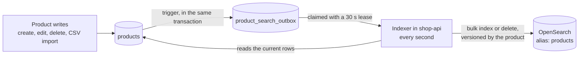

# Product search

Search runs on OpenSearch 3.5, and Postgres stays the source of truth. A database trigger queues every product change, and an indexer in shop-api sends the queued changes to OpenSearch.

## How the index stays in step with the database

- **Every product change is queued in the same transaction.** A database trigger writes the outbox row, so no write path can forget, whether it is the API, the CSV import or a future batch load. It only fires for the fields the index uses, so the stock changes made by orders don't touch it.
- **The indexer sends changes outside any transaction.** It claims up to 500 queued changes with `FOR UPDATE SKIP LOCKED` and a 30 s lease, reads the current rows, and sends one bulk request. A change leaves the queue only after OpenSearch accepted it, and a failed one is retried when its lease runs out.
- **A late, older update can't overwrite a newer one.** Each document carries the product's version as an external version, so OpenSearch refuses anything older than what it has. A delete is sent with the deleted row's version plus one, so it wins over any update queued before it.
- **So every write to a product's name, description, category or price must increase its `version`.** OpenSearch refuses a document whose version isn't higher than the one it holds, and the indexer counts that refusal as done, so a write that keeps the version would never reach the index. TypeORM's `save`, `update` and query builder updates increase it through `@VersionColumn`. Raw SQL, such as a bulk upsert, has to set `version = products.version + 1` itself.
- **The index sits behind the alias `products`.** Its settings and mappings are versioned in code, in `product-index.definition.ts`, and `dynamic: strict` refuses any field the code doesn't declare.
  - On first start, the indexer creates the index and queues every product. It does the same if the index goes missing later.
  - `pnpm --filter shop-api search:rebuild` builds a new index from Postgres, switches the alias to it, queues every product again to catch changes made in the meantime, and deletes the old index. In Docker, run `docker compose exec shop-api node dist/products/search/rebuild-search-index.js`.

## When OpenSearch is down

- **Changes stay queued in Postgres.** The indexer logs once that it is waiting and catches up when OpenSearch is back.
- **shop-api's health check doesn't include OpenSearch,** so a search outage doesn't take the whole API out of rotation.

## How it is tested

The e2e tests run against a real OpenSearch 3.5 in Testcontainers, shared by the whole run, with a 512 MB heap and security off. Each suite starts from a fresh index made with the same definition the app uses, so a test can't pass on mappings production doesn't have.

| Suite | What it covers |
|---|---|
| `product-search-index.e2e-spec.ts` | Writing to the index: versions, deletes, unknown fields, an OpenSearch it can't reach |
| `product-search-outbox.e2e-spec.ts` | Queuing product changes: what the trigger queues and with which version, claims and leases |
| `product-search-sync.e2e-spec.ts` | The indexer and rebuilds: creates, renames, deletes, CSV imports, a missing index, a rebuild |
| `product-search-unavailable.e2e-spec.ts` | shop-api pointed at an address with no OpenSearch: changes stay queued |

**No test sleeps.** A test runs the indexer once instead of waiting for it.

Each of these tests was seen failing against a deliberately broken version of the code:

| Guarantee | Test | Broken version it catches |
|---|---|---|
| A late, older update can't overwrite a newer one | "ignores an older version of a product that arrives late", in the index suite | external versions removed from the bulk request |
| Every change that matters is queued | "queues every create, edit and delete with the version the index should get", in the outbox suite | `name` left out of the trigger |
| The CSV import is queued with a new version | "queues the products a CSV import creates or changes, with a new version", in the outbox suite | the import's update keeps the old version |
| A change leaves the queue only once OpenSearch took it | "recreates a missing index, keeping the changes it could not send", in the sync suite | the indexer completing every claimed change, sent or not |

## Decisions

- **OpenSearch rather than Elasticsearch.** Amazon's managed service runs OpenSearch, and Elastic's own client refuses to connect to OpenSearch, so matching AWS means running OpenSearch locally too. 3.5 is the newest version Amazon OpenSearch Service lists.
  - *Elasticsearch* would fit Elastic Cloud on AWS instead.
  - *Postgres with `pg_trgm`* needs no extra service and is fast enough for this catalog. OpenSearch was chosen for ranking, typo tolerance and analyzers, and to keep search traffic off the database as the catalog grows.
- **A trigger fills the outbox,** rather than a call in each command handler. A call is more visible in the code, but a new write path could forget it, and the batch import coming next writes products in bulk.
- **Moving to AWS** needs only configuration for the address. The client ships a SigV4 signer for Amazon OpenSearch Service, and the index needs replicas there. Both are listed in `KNOWN_ISSUES.md`.
